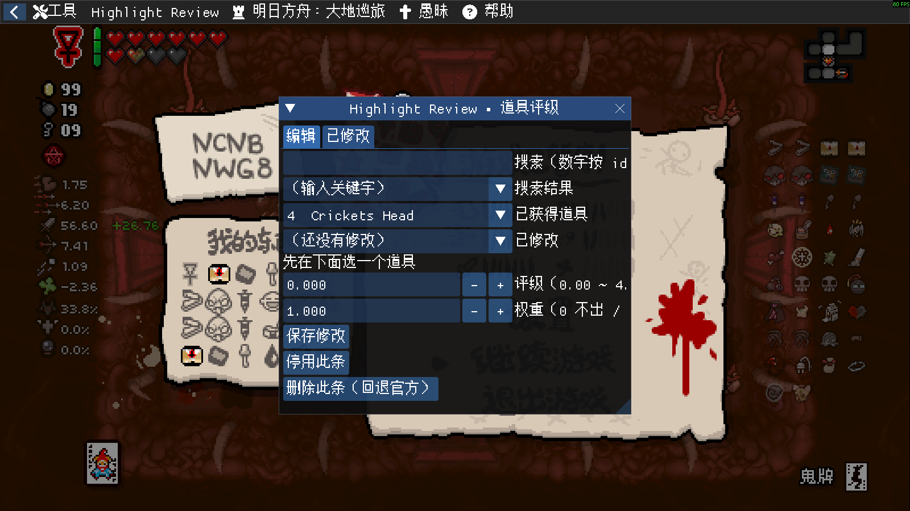

# Item Weight Editor · 道具权重编辑器

改**任意道具的掉落权重**，让它出现得更少、或者干脆不出现。

举个最常用的场景：恶魔房里老是刷到你不想要的硫磺火？把它的权重设成 `0`，从此不会再出现。

> 需要 **REPENTOGON**。这是独立 mod，**不依赖** Highlight Review。



---

## 怎么用

默认按 **F6** 打开（也可以走 ImGui 顶栏 `Item Weight` → `设置` 改键）。

窗口里有三个入口，都是为了让你**不用背道具 id**：

| 入口 | 用途 |
|---|---|
| **搜索** | 输数字按 id 找，输字母按英文名找。**搜到结果会自动选中第一个** |
| **已获得道具** | 只列你现在身上有的道具，点一下就选中 |
| **已修改** | 已经改过的那些，点一下继续改 |

选中一个道具后，改两样东西：

| 项 | 范围 | 说明 |
|---|---|---|
| **权重** | `0.00` ~ `5.00` | `0` = 完全不出现；`0.5` = 出现率减半；`1.00` = 原样 |
| **评级** | `0.00` ~ `4.99` | 覆盖官方品质。配合 Highlight Review 可影响「四级道具」判定 |

改完点 **`保存修改`** 才写盘（按钮会带 `*` 提示你有未保存的改动）。

底下两个按钮：

- **`停用此条` / `启用此条`**：临时开关，**保留**你填的数值
- **`删除此条（回退官方）`**：彻底删除这条覆盖

第二页「已修改」是**纯展示**，把改过的全部列出来，不用于选择。

## 重要限制

> ⚠️ **权重目前只能降低，不能提高。** 填大于 `1.00` 的值会被保存，但**不生效**。
>
> 原因是「提高出现率」需要绕过游戏的抽取逻辑重新分配概率，风险远高于「拒绝并重掷」，留到以后做。

- **按存档槽存**：1/2/3 号档各有一份配置。想让三个档共用一套，用 `tools\sync-rating.ps1`
- **改完下个房间生效**，不需要重启
- 只影响**道具池抽取**（宝箱房、Boss 房、恶魔房这些），不影响你已经拿到的道具

## 数据在哪

```
<游戏目录>\data\highlight-rating\save1.dat   ← 存档槽 1
                                  save2.dat
                                  save3.dat
```

纯文本，可以用记事本打开：

```
IWE1
Q={"v":1,"e":{"118":{"q":3.75,"w":0}}}
C={"f6":295}
```

| 行 | 内容 |
|---|---|
| `IWE1` | 文件头 |
| `Q=` | 道具权重与评级（JSON） |
| `C=` | 热键设置 |

### 局外工具

| 工具 | 用途 |
|---|---|
| `tools\rating.ps1` | 列出各存档槽的配置 |
| `tools\sync-rating.ps1 -From 3` | 把 3 号槽的配置同步到另外两个槽 |

## 语言 / Language

支持**中文**和**纯英文**两套界面。

切换位置：ImGui 顶栏 `Item Weight` → `设置`（英文界面下是 `Settings`）→ **语言 / Language** 两个按钮。

- 切换后**需要重启游戏**才生效（原因见下）
- 英文模式下**道具名也用英文**（中文模式用本地化名）
- 选择存在存档里：`C={"f6":295,"lang":"en"}`

> 只有本 mod 做双语；**Highlight Review 保持中文**。
>
> ⚠️ **为什么不能立即生效**：ImGui 的控件标签只能在创建窗口时给定，改语言必须重建窗口，
> 而实测 `ImGui.RemoveWindow` 会让游戏直接崩溃（minidump）。所以语言在**读档之后、建窗口之前**
> 确定一次，切换后重启游戏即可。
## 与其他 mod 的关系

**独立运行**，装不装其它 mod 都能用。

如果你同时装了 **Highlight Review**，它会通过 `_G.HLR` 读到你的评级，用于「四级道具」判定。没装的话，Highlight Review 就用官方品质，一切正常。

游戏里可能同时被别的 mod 改道具池 —— 本 mod 排在**最后**处理抽签结果，只微调别人抽出来的东西，不会推翻它们的决定。
